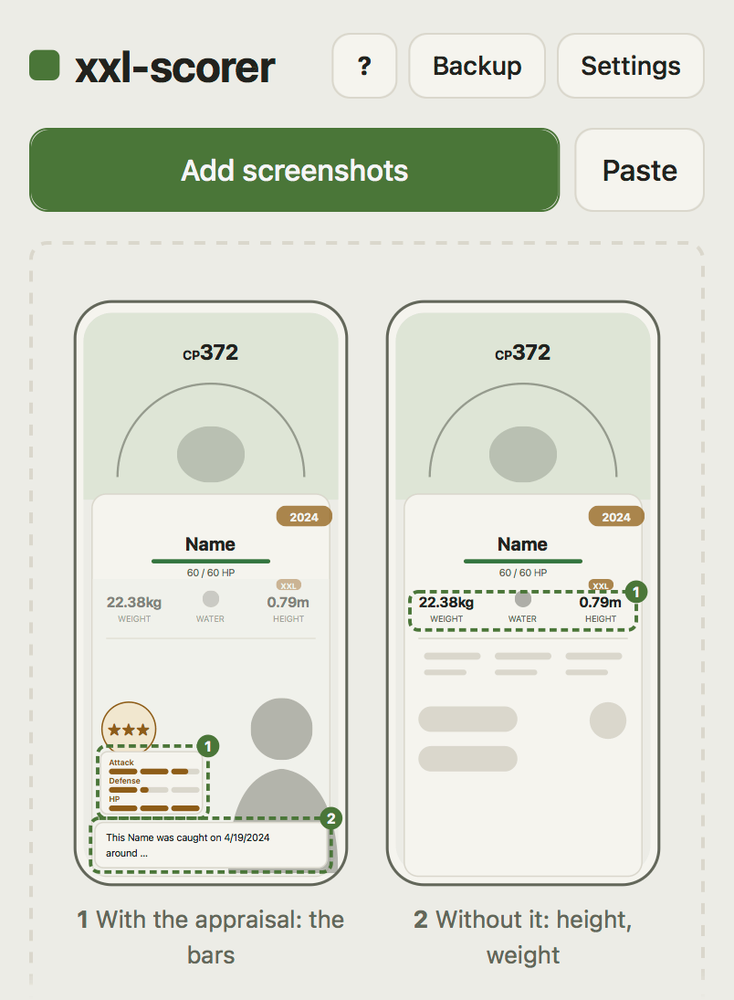

# xxl-scorer



Score your Pokémon GO screenshots for **size showcases** ("biggest" PokéStop showcases), any day
of the week, not only on the days the game shows the score. Drop in a batch of screenshots, get a
table sorted by showcase points.

- Reads species, CP, HP, height, weight and catch date, and the IVs from the appraisal bars
- Puts several screenshots of one Pokémon together, so a quick swipe through your storage works
- Score with a ± range (the game rounds the sizes); an XXS mode for "smallest" showcases
- Search with the game's own terms: `xxl`, `4*`, `cp700-800`, `rock,flying&!lucky`, …
- Copies a ready-made nickname, such as XX1063¹⁸⓿㉚
- Every value can be corrected; a backup file moves the list to another device

Runs entirely in your browser: screenshots are read on your device and never uploaded. No
account, no server, no AI service.

**Use it:** <https://alanceil42.github.io/xxl-scorer/> (the latest release), or run your own
copy (below).

> Unofficial fan tool. Not affiliated with or endorsed by Scopely, Nintendo, Creatures, GAME FREAK
> or The Pokémon Company. Pokémon and Pokémon GO are trademarks of Nintendo.

<br clear="right">

## Try it

To run your own copy: it's just files, so point any web server at the folder and it runs.
Python 3 (preinstalled on
macOS and most Linux systems) has one built in:

```sh
git clone https://github.com/alanceil42/xxl-scorer.git
cd xxl-scorer
python3 -m http.server 8000
```

(No git? On the [latest release][latest], download "Source code (zip)", unpack it, and run the
last line in that folder. `git clone` gets main, which may hold changes not released yet.)

[latest]: https://github.com/alanceil42/xxl-scorer/releases/latest

Then open <http://localhost:8000/>. Any other static server works too (`npx serve`,
`php -S localhost:8000`, …). Opening `index.html` straight from the disk does not: browsers
won't run JavaScript modules from `file://`.

- The list is stored per address, port included: keep using the same port, or export a backup
  (step 5 below) before changing it.
- `python3 -m http.server` listens on your whole network, so a phone on the same Wi-Fi can open
  `http://<your computer's IP>:8000/`. Over plain http to another device, **Paste** doesn't work
  (browsers allow clipboard access only on https or localhost); use Add screenshots instead.
  Add `--bind 127.0.0.1` to keep it to your computer.
- To keep it running for good, see [Hosting](#hosting).

## Using it

1. In the game, open a Pokémon and **appraise it** so the three IV bars are visible. Take a
   screenshot. Where the trainer covers the height or weight, close the appraisal and take a
   second one. On a 16:9 phone (iPhone 8, SE) the appraisal always covers them: take every
   Pokémon with and without it. Do this for every Pokémon you want to compare; swiping through
   the storage and screenshotting each one twice is fine, the screenshots are put together again
   (step 3). The **?** button shows a drawing of the two.
2. Open xxl-scorer and press **Add screenshots** (or drop the files onto the page). Pick as many
   as you like. A screenshot taken with "Copy & Delete" goes in with **Paste** (the clipboard
   button next to it). On a Mac, the file dialog usually lists the Photos library in its
   sidebar (under Media), or drag pictures from the Photos app onto the page.
3. Each screenshot becomes a row: score ± range, species, IVs, level, height, weight, catch date.
   Click a row to check or correct anything; every value can be edited. To remove many at
   once, press **Select** (the checklist button), tap the rows, then **Delete**. Several
   screenshots of the same Pokémon (say, one with the appraisal and one without the trainer in
   front, or a quick swipe through the storage) merge into one row; one caught mid-swipe,
   between two Pokémon, is skipped. The button with the name (XX1063¹⁸⓿㉚: score, IV %, attack
   IV, level) copies it, ready to paste as the nickname in the game; change the pattern in
   Settings (the gear: "Name to copy"). The magnifier in a frame before it copies a search
   that finds this one Pokémon in the game's storage (`641&xxl&cp1900&hp121&4attack&…`):
   paste it into the game's search, open the Pokémon, then paste the name. If the search also
   fits another Pokémon in your list, the note at the bottom says so.
   The list is sorted by score. The **sort** button (two arrows, at the end of the search row)
   sorts by Newest, CP, Pokédex number, name, IVs or catch date too; pick the current one again
   to reverse it. Right after adding screenshots the list shows the newest first, so new and
   rescanned Pokémon are at the top, ready for their nickname; the button is tinted while the
   list isn't sorted by score.
4. **Search** narrows the list: a name, or the game's own search terms: `cp700-800`, `hp100-`,
   `xxl`, `xxs`, `lucky`, `4*` (stars), `3-4attack`, `rock`, `74` (Pokédex number), `year2024`,
   plus `score1100-`.
   Combine them as in the game: `,` or, `&` and, `!` not (`rock,flying&!xxl`). In select mode,
   **All** marks only what the search shows.
5. **Backup → Export** now and then (a dot on Backup means there are unexported changes). The list
   lives only in this browser, and browsers may delete it (Safari does after 7 days without a
   visit). Import the file to restore it or move it to
   another device.

The first time, the page downloads the text recognition engine (about 4 MB) and the game data
(about 2 MB). After that it checks for new game data once a week.

What is read from a screenshot: the species name and catch date from the line "This … was caught on
…" (or the species from the name, when the Pokémon has no nickname, and the date from the year tag
on the card), HP, CP, height, weight, and the IVs from the appraisal bars (by measuring their
pixels). XXL is derived from the height. The score follows the community-verified formula in
[docs/HOW-IT-WORKS.md](docs/HOW-IT-WORKS.md), shown with a ± range because the game rounds height
and weight to two decimals.

**XXS mode** (Settings → Showcase → Smallest) is for showcases of the smallest Pokémon, should the
game run them: the same score, the lowest wins. That is an assumption until such a showcase
happens.

Tested so far with English game text and iPhone screenshots (19.5:9 and 16:9 screens) from
players of all three teams. If a screenshot is read wrong,
please open an issue ("A screenshot isn't read correctly"); the template explains how to hide
the catch location first.

## Where the game data comes from

The repository contains **no game data, game texts, game images or screenshots from the game**
(the picture at the top shows only xxl-scorer's own drawings). Species data (sizes,
base stats, level multipliers) and the game's texts (names, the "was caught" line) are fetched
by your browser from [PokeMiners](https://github.com/PokeMiners)' public repositories on GitHub
and kept on your device. This means your browser contacts GitHub (as any web page would that
loads something from there). To avoid that, host it yourself with your own game data file (see
below) or import a file in Settings. Background: [docs/HOW-IT-WORKS.md](docs/HOW-IT-WORKS.md).

## Hosting

It's a static site: any web server works, there is no build step (to just try it, see
[Try it](#try-it)).

- **GitHub Pages:** `.github/workflows/pages.yml` publishes each release (Settings → Pages →
  Source: GitHub Actions; in Settings → Environments → github-pages, allow the tags `v*`). Your
  settings (below) go into a repository variable `SITE_CONFIG` (Settings → Secrets and
  variables → Actions → Variables) holding what would be `local/config.json`. Or, without the
  workflow: Settings → Pages → Deploy from a branch → `main`, `/ (root)`.
- **Codeberg Pages** and other hosts that serve a branch: the repository root as it is. The
  empty `.nojekyll` file makes GitHub serve the files as they are, too.
- **Your own server:** step by step in [docs/INSTALL.md](docs/INSTALL.md) (Debian, nginx,
  systemd). The files in `contrib/` expect the site in `/opt/xxl-scorer`, served under `/xxl/`;
  elsewhere works too, with three paths changed. Serve JavaScript gzipped.
- **Without third-party requests:** build the game data yourself and point the page at it:
  ```sh
  mkdir -p local/data
  tools/build-gm.sh -l en -o local/data/gm.json            # needs bash, curl, jq
  echo '{"gm": "local/data/gm.json"}' > local/config.json
  ```
  [contrib/systemd/](contrib/systemd/) has a service and timer that rebuild it weekly, run by a
  system user from [contrib/sysusers.d/](contrib/sysusers.d/); install steps are at the top of
  the service file.

Give it a host name of its own if you can (`xxl.example.org` rather than `example.org/xxl/`):
browsers share stored data and logins between everything on one host name, so the list and any
other app there could reach each other. On GitHub Pages that takes a custom domain, since all
project pages of an account share `<account>.github.io`. The page carries its own
Content-Security-Policy (in `index.html`), which also covers the text recognition engine; if
`"gm"` points to another host, add that host to its `connect-src`. The nginx example sends the
same policy as a header, with what a page can't set itself (no framing, and a few more): keep
the two the same.

Everything stays in the one directory. Your own settings and data go into `local/`, which is
not part of the repository, so an update never touches them: replace everything else, keep
`local/` (with a git checkout, `git pull` leaves it alone anyway).

Settings: `config.json` holds the defaults; `local/config.json`, if present, overrides any of
them.

- `"gm"`: `"upstream"` (default, PokeMiners via GitHub), the URL of a `gm.json`, or `"off"`
  (only files imported by hand).
- `"gmCheckDays"`: how often the page asks for new game data, in days (default 7). The weekly
  default matches the showcase rhythm; much longer gains little, because Safari deletes a
  site's stored data after 7 days without a visit anyway.
- `"lang"`: game language (`"en"`).
- `"imprintUrl"`, `"imprintLabel"`: a link in the footer to the site operator's legal notice
  (Impressum), where the place you host it needs one; it opens in a new tab. Empty (the
  default): no link. The label defaults to "Legal notice".

## Development

```sh
npm run serve           # python3 -m http.server 8000, then open http://localhost:8000/
npm test                # public tests, made-up game data, no network
tools/vendor.sh --check # vendored engine files match vendor/SHA256SUMS
```

No dependencies and no build: plain JavaScript modules.

- `src/core/` pure logic, runs in the browser and in Node: game data compaction, text rules,
  IV solver, appraisal bars, score, evaluation
- `src/ui/` the page: storage (IndexedDB), game data loading, the tesseract.js worker, table
- `src/rules/` per game language: what the game's own text tables don't provide
- `vendor/` third-party files copied into the repo ("vendored"): tesseract.js (Apache-2.0) and
  its English model, and the buttons' icons from Lucide (ISC) as one sprite, at the versions in
  `vendor/PINS`, checked by hash. `tools/vendor.sh` fetches
  them from the npm registry; `--outdated` lists newer versions, `--update` moves to them within
  the same major version. Updates are never automatic: after one, run the tests below and try
  the page.
- `tools/build-gm.sh` the game data compaction in bash + jq, kept identical to the JS by a test
- `docs/HOW-IT-WORKS.md` the core: the score formula, the IVs, reading and merging screenshots
- `CHANGELOG.md` what changed in each release; `docs/RELEASING.md` how a release is made

**Tests with real screenshots** stay local, because screenshots show where Pokémon were caught:

```sh
npm install --no-save tesseract.js@$(tools/vendor.sh --version tesseract.js)   # Node build, same version
XXL_FIXTURES=/path/to/my/screenshots npm test
```

That folder holds the screenshots and an `expected.json` (format at the top of
`tests/fixtures.test.js`), and optionally `latest.json` and `i18n_english.json` (otherwise
they are downloaded).

**Another game language** needs a file in `src/rules/` (Tesseract language code, anything special
about the layout), its entry in `LANGUAGES` in `src/core/text.js` and in `tools/build-gm.sh`, and
the matching Tesseract model in `vendor/tessdata/`. The patterns and species names come from the
game's text tables automatically.

## License

Code: [MIT](LICENSE). Vendored files keep their own licenses (see `vendor/`). Game data is not
part of this project; it is loaded at runtime from PokeMiners.
